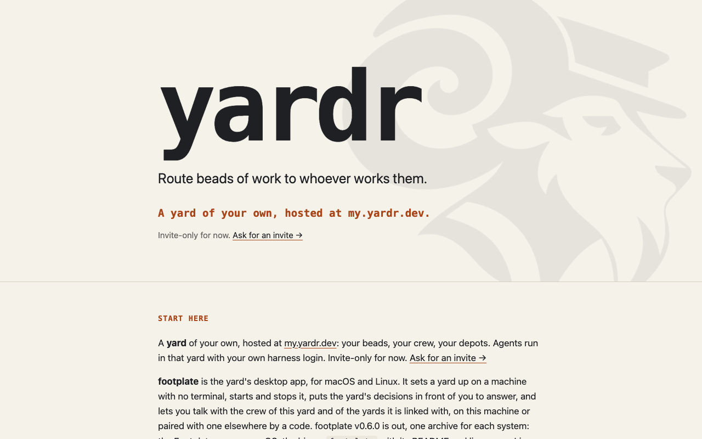
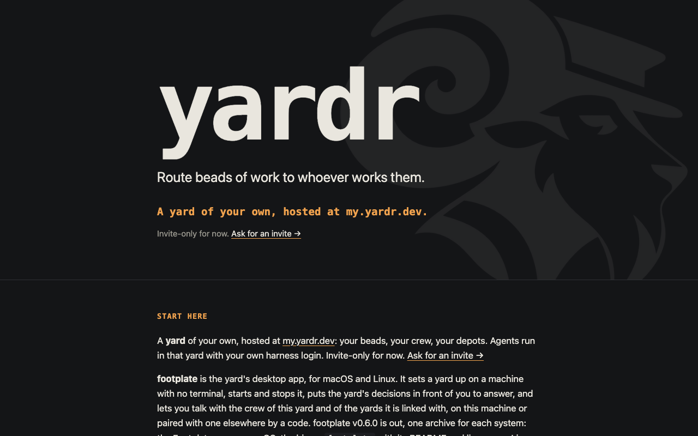
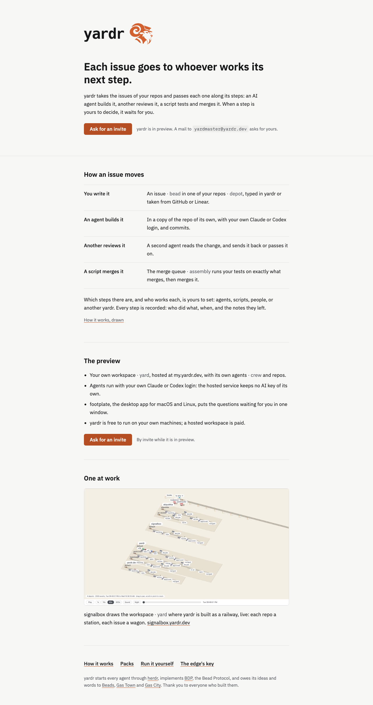
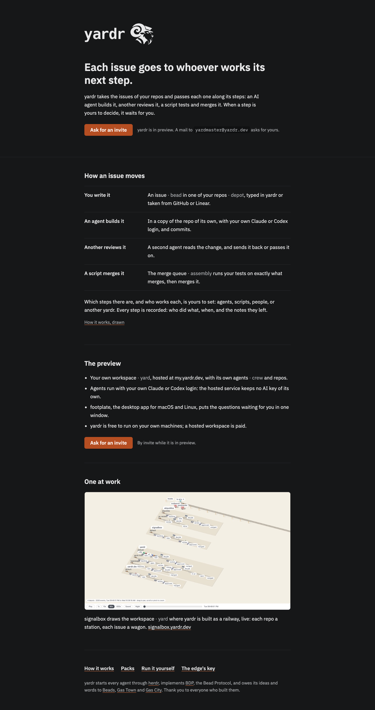

# yardr.dev overhaul: plain words, the real logo, a preview invite instead of downloads

Design yardr-q04p, proposed 2026-10-21. A proposal as it was decided on, not a description of what the code does today; the decision is on the bead.

The site lives in the yardr.dev repository (`~/projects/repos/yardr.dev`,
read at commit 44603f2); this document and its pictures live in the yardr
repository, beside it in
[`2026-10-21-yardr-q04p-site-overhaul/`](2026-10-21-yardr-q04p-site-overhaul/).
"The design system" below means the repository yardr-dev/yardr-design
(`~/projects/repos/yardr-design`, read at commit d6d3cb6): its `readme.md`,
`SKILL.md`, `tokens/` and `guidelines/`.

## 1. The question

mckean asked for an "overhaul!" of yardr.dev on 21 October (Telegram 58109
to 58142). Today the site is written for someone who already knows the
yard; afterwards a stranger should be able to tell from the front page what
yardr does for them and how to get into the preview. Three asks, in his
words: "we could also remove the download and mention preview with the
email"; "use the real logo, the mark in the background (big) can remain";
and plain words first, the yardmaster's proposal he took up, where a railway
word that stands in for an everyday one is shown as the everyday word with
the railway word beside it ("issue · bead", "repo · depot"), and words with
no everyday equivalent (yardmaster, refinery, siding) stay as they are. A
fourth came at 12:03 the same day: "styleguide too, i mean adhere to it",
meaning the whole site follows the design system, not only the logo.

## 2. What exists today

**The front page**, `src/pages/index.astro` (436 lines):

- The hero (`:62-73`) is the text `<h1>yardr</h1>` set in the system
  monospace at up to 11rem, the lede "Route beads of work to whoever works
  them.", a rust line "A yard of your own, hosted at my.yardr.dev." and
  "Invite-only for now. Ask for an invite →", a `mailto:` link to
  `yardmaster@yardr.dev` with the subject "yardr invite" (`:70`; the address
  forwards through Cloudflare Email Routing, per bead yardr.dev-bm47).
- The ram (`:15-17`, styled at `:263-288`) is `brand/logomark.png`, resized
  to 800 px and drawn as a CSS mask over the text colour at 7% opacity, so
  one file serves both themes. Its comment says "decoration, never the
  logo".
- "Start here" (`:76-139`) repeats the invite (`:82`) and then offers
  footplate's download: the version, one archive per system read from
  `public/releases/footplate/latest.json`, the checksums file, the minisign
  signature and a paragraph on how to check them.
- "What it does" (`:141-170`) defines bead, route, stage, group and runner
  in one paragraph and shows the four runners as bordered cards.
- "Principles" (`:172-193`), "Around the yard" with the signalbox picture
  (`:195-215`), and a footer of acknowledgements with the one link to
  `/self-host` (`:218-241`).

The current front page, as served on 21 October at 1280x800:

| light | dark |
|---|---|
|  |  |

**The other pages.** Each is a whole HTML document with its own copy of the
head, the header, the "← yardr.dev" footer and the heading styles; there is
no shared layout component.

| page | lines | what it holds |
|---|---|---|
| `src/pages/how.astro` | 402 | "How yardr works": the starter flow drawn (`src/assets/flow.svg`), "The words" (a glossary in two lists, `:11-60`), the starter pack's files, one bead's event log |
| `src/pages/self-host.astro` | 207 | the three steps to start a yard, and yardr's release archives read from `public/releases/latest.json` |
| `src/pages/edge.astro` | 132 | the public key of the edge at my.yardr.dev, from `edge.pub` |
| `src/pages/packs/index.astro`, `packs/[name].astro` | | the packs list with tag chips and search, and one page per pack with its files, built from `src/data/packs.json` |
| `src/pages/404.astro` | | "Not here" |

**Who reads the site besides people.** These addresses are read by programs
and stay where they are whatever the pages become:

- `https://yardr.dev/releases/latest.json` and the archive, `checksums.txt`
  and `checksums.txt.minisig` it names: footplate fetches yardr from there
  (`footplate/src/fetch.rs:63`, `LATEST`, and `RELEASES = "/releases/"`;
  footplate's README, "yardr comes from one host"), and refuses any other
  host.
- `https://yardr.dev/releases/footplate/latest.json`: written by
  `scripts/sync-release` (`:188`, the prefix per product) and checked by
  footplate's `scripts/release-stage:331-335` after a release. footplate
  has no self-updater reading it today (no reference in `footplate/src`),
  but it is the documented address for a program.
- `https://yardr.dev/packs/starter/` and the other pack directories under
  `public/packs/`: `yardr pack import` fetches a pack from a URL ending in
  `/` (`internal/cli/pack.go:301`, `docs/packs.md:290`).
- `https://yardr.dev/edge`: `yardr edge connect` prints it as the page to
  compare the key with (`internal/cli/edge.go:29`, `docs/edge.md:32`).
- `scripts/sync-release` and `contrib/release/stage:414-416` in yardr write
  and check `public/releases/`; neither reads a page.

**The site's styles**, `src/styles/global.css`: its own palette (paper
`#f5f2ea`, ink `#1f2024`, accent `#a8461a`; dark: `#141517`, `#e9e6de`,
accent `#f0a24e`), `system-ui` and `ui-monospace`/`SF Mono` font stacks, and
per page: section headings in monospace capitals with `letter-spacing:
0.08em`, the runners and the pack list as bordered cards, "→" and "←" as
link glyphs. 

**The design system.** Dark is the default theme and light is opt-in
(`tokens/colors.css`); one accent, yard rust `#D3602F` with rust 600
`#B54E22` as the primary button fill and as accent text on light; IBM Plex
Sans and Plex Mono, Hack 700 only inside the lockup; five type roles sized
for a 340 px panel (title 15/600 down to meta 12/400); a spacing scale of
2/4/6/8/12/16/20/24; flat surfaces; only decision items are cards; no
all-caps labels; no unicode characters as icons; and the content rule
"The railway vocabulary is the model, not decoration — never genericize it"
(`readme.md`, Content fundamentals). The lockup is lowercase **yardr** in
Hack 700 with the ram, stacked or with the mark on the right, as fixed
files `assets/lockup/yardr-lockup-<stacked|mark-right>-<dark|light|accent>.svg`:
dark (ink word) for light surfaces, light for dark surfaces, and accent (a
rust mark with a dark word) never with a light word (`readme.md`, Lockup and
Brand mark). The mark in every file is still an auto-trace, which the
readme says should be cleaned by hand before large-format use.

yardr.dev's own `.yardr/depot.md` already sends every `eyes` bead to the
design system and says "copy tokens from `tokens/`, never invent colours or
words"; the site predates that rule and follows it nowhere.

## 3. The proposal

### 3.1 The audience, and the one thing the front page asks of them

The reader is a developer or a small team lead who has heard of yardr, or
landed from a link, and does not know the yard. They already run an AI
coding agent (Claude Code, Codex) by hand on their own issues. What they
need to learn in one screen: yardr takes the issues of their repositories
and hands each step of each one to whoever works it (an agent builds, a
second agent reviews, a script tests and merges, a person decides), and
there is a preview they can get into.

The one thing the front page asks of them is to **ask for a preview
invite**: the existing `mailto:yardmaster@yardr.dev?subject=yardr%20invite`,
drawn as the page's one primary button. It stands twice: in the hero, and
again under "The preview". Every other link on the page is secondary.

### 3.2 The page map

| page | fate | its job, in one line |
|---|---|---|
| `/` | rewritten | say what yardr does in plain words and ask for a preview invite |
| `/how` | stays, takes "Principles" from `/` | show how an issue moves, drawn, and every word the yard uses with its plain word |
| `/self-host` | stays, takes footplate's download from `/` (open question 3) | run yardr on your own machines: the steps and the release archives of yardr and footplate |
| `/packs`, `/packs/<name>` | stay | list the ways of working yardr ships, each with its files |
| `/edge` | stays | publish the edge's key for `yardr edge connect` to be compared with |
| `/404` | stays | say the address has no page, and link home |
| `/releases/…` | stays, no page | the files programs read (section 3.5) |

No page goes and none merges: every page has a reader, and two of them
(`/edge`, `/packs/<name>/`) have programs naming them. The pages share one
layout component instead of six copies of the head and footer, so the
styleguide is applied once (bead 1 in section 6).

### 3.3 The front page, section by section

The mockups below are `front.html` in the pictures folder, built from the
design system's tokens and the real lockup files and shot at 1280 px wide
(full page). They show the words this design proposes; the words are
mckean's to change at the decide stage.

| light | dark |
|---|---|
|  |  |

**Hero.**

- The logo: the **mark-right lockup** (the word, then the ram on its
  right), 240 px wide, as the fixed file from the design system, never
  retyped. On the light theme the **accent** file (rust ram, ink word); on
  the dark theme the **light** file (light ram, light word). Both pairings
  are the readme's: accent never with a light word, so the dark theme takes
  the light file. The mark-right lockup is chosen over the stacked one
  because the stacked one puts a second ram directly above the headline,
  under the big ram, and doubles the height of the hero before any words.
  The lockup is the page's `<h1>`'s neighbour, not its text: an `img` with
  `alt="yardr"`.
- The ram behind stays as mckean asked: the same mask technique as today,
  over the text colour at about 6% opacity, at the right of the hero, but
  drawn from the design system's `assets/yardr-mark.svg` instead of
  `brand/logomark.png`, so the site carries one mark and not two.
- Headline (`<h1>`): "Each issue goes to whoever works its next step."
- Lede: "yardr takes the issues of your repos and passes each one along its
  steps: an AI agent builds it, another reviews it, a script tests and
  merges it. When a step is yours to decide, it waits for you."
- The invite: the primary button **Ask for an invite** and beside it, in
  secondary text, "yardr is in preview. A mail to `yardmaster@yardr.dev`
  asks for yours." The address is shown, because a `mailto:` link does
  nothing on a machine with no mail client.

**How an issue moves.** Four rows, a short bold step on the left and one
line on the right, separated by hairlines (rows, not cards):

1. You write it: "An issue · bead in one of your repos · depot, typed in
   yardr or taken from GitHub or Linear."
2. An agent builds it: "In a copy of the repo of its own, with your own
   Claude or Codex login, and commits."
3. Another reviews it: "A second agent reads the change, and sends it back
   or passes it on."
4. A script merges it: "The merge queue · assembly runs your tests on
   exactly what merges, then merges it."

Then: "Which steps there are, and who works each, is yours to set: agents,
scripts, people, or another yardr. Every step is recorded: who did what,
when, and the notes they left." and the link "How it works, drawn" to
`/how`. This replaces today's "What it does", whose runner cards
(`herdr`, `exec`, `manual`, `peer`) move to `/how`, where the reader who
wants the machinery is.

**The preview.** Four plain points and the invite again:

- "Your own workspace · yard, hosted at my.yardr.dev, with its own agents ·
  crew and repos."
- "Agents run with your own Claude or Codex login: the hosted service keeps
  no AI key of its own." (yardr-hosted README, D2.)
- "footplate, the desktop app for macOS and Linux, puts the questions
  waiting for you in one window."
- "yardr is free to run on your own machines; a hosted workspace is paid."
  No figures (left out, section 4).
- The button again, with "By invite while it is in preview."

**One at work.** The signalbox picture as today, with one line: "signalbox
draws the workspace · yard where yardr is built as a railway, live: each
repo a station, each issue a wagon." and the link to signalbox.yardr.dev.
signalbox's own railway words (station, wagon, shunter) describe a drawing
of a railway, so they stay. The picture is the railway imagery the design system
asks for, not a background; section 3.6 says how it meets the rules.

**Footer.** One row of links: How it works (`/how`), Packs (`/packs`), Run
it yourself (`/self-host`), The edge's key (`/edge`); then the
acknowledgements as one paragraph (herdr required, BDP implemented, Beads,
Gas Town and Gas City as inspiration, the thanks), shortened from today's
six paragraphs with nothing dropped.

**Gone from the front page:** the footplate download block (section 3.5),
"Principles" (to `/how`), the runner cards (to `/how`), and the paragraph
on roles and depots.

### 3.4 The words

The rule, for the site only: where a railway word stands in for an everyday
one, the everyday word comes first and the railway word follows it after a
middle dot, in secondary text colour, as one unit: "issue · bead". Where a
word has no everyday equivalent, or is a product's name, it stays as it is,
explained where it first appears. Commands and file names shown in mono
(`yardr bead show`, `pack.yaml`) are never translated: they are what a
person types.

It is carried by one small component, `src/components/Word.astro`, used as
`<Word plain="issue" yard="bead" />`, so the pairing looks the same on
every page and a later change of a plain word is one edit to a table. The
table lives in one file, `src/data/words.ts`, which `/how`'s "The words"
section also reads (today its glossary is an inline array in `how.astro`,
`:11-60`), so the site states each pairing once. How often the pair is
shown on a page is open question 2.

| railway word | uses on the site | shown as | why |
|---|---|---|---|
| bead | 49 | issue · bead | the everyday word for a durable unit of work; the glossary already says "an issue, in a tracker" |
| depot | 24 | repo · depot | a depot is a git repository or a plain directory; where a page means both, "repo or folder · depot" |
| yard | 30 | workspace · yard | one installation of yardr; the plain word is open question 6 |
| crew, crew member | 18 | agents · crew, agent · crew member | the always-on agents of a yard |
| assembly | 6 | merge queue · assembly | the group that tests an approved change and merges it; the plain word is open question 6 |
| line | in the glossary and the flow page | pipeline · line | what an issue travels through in one repo |
| train | glossary, packs | grouped change · train | an issue whose sub-issues merge as one |
| wagon (the bead) | glossary, packs | sub-issue · wagon | a child of a train |
| lands, landing | 3 | merges · lands | reaching the base branch |
| flow, stage, route, group, runner, session, outcome, pack, hook, source, link, peer, edge | many | as they are | already plain words for general machinery; `/how` already says so ("plain words, kept because they name general machinery") |
| yardmaster | 11 | as it is | no everyday equivalent (mckean's example): the agent that coordinates the yard, explained at first use |
| refinery | 1 | as it is | a name of one group in yardr's own yard, in `/how`'s event log; no equivalent (mckean's example) |
| siding | 3 | as it is | a stage off the main line where a person answers (mckean's example); explained in the flow figure's caption |
| shunter, station, platform, track, wagon (in signalbox's drawing) | a few | as they are | they describe a railway drawing, not stand in for a word |
| footplate, signalbox, herdr, yardr | | as they are | product names, lowercase |

This rule contradicts the design system's content rule ("never genericize
it", `readme.md`, Content fundamentals), which every `eyes` bead on
yardr.dev is told to follow. mckean took the plain-word proposal, and the
critique checks the site against the design system, so the two must agree
before a page changes: open question 1.

### 3.5 What happens to the downloads

- The front page stops offering footplate's download. The invite is the way
  into the preview.
- Nothing under `public/releases/` moves, is renamed, or stops being
  served: `latest.json` and the archives, checksums and signatures of yardr
  and of footplate stay at the addresses in section 2, because footplate
  fetches yardr from `/releases/latest.json` and refuses any other host,
  `scripts/sync-release` writes there, and `contrib/release/stage` checks
  the result there. `scripts/sync-release` is not changed.
- footplate's download block (the archive per system, the checksums
  paragraph) moves as it is to `/self-host`, under yardr's, as "footplate,
  the desktop app" (open question 3 has the other choices). The block's
  code, which reads `public/releases/footplate/latest.json` at build time,
  moves with it, so the next footplate sync updates the page as today.
- `README.md` of yardr.dev, which says "The start page reads the same file
  for its downloads" twice, is corrected in the same bead.

### 3.6 Styleguide adherence

Each rule of the design system the site breaks today, and how the new
pages meet it. "Web scale" refers to open question 4.

| rule (design system) | the site today | the new pages |
|---|---|---|
| Colours come from `tokens/colors.css`; one accent, yard rust | its own palette in `global.css`: cream paper `#f5f2ea`, ink `#1f2024`, accent `#a8461a`; dark accent `#f0a24e`, an amber that is no rust at all | `global.css` takes the token names and values as they are (surfaces, borders, text, `--text-accent`, `--button-primary*`, `--focus-ring`) for both themes; the site's own variables go |
| Accent text is rust 600 `#B54E22` on light, rust 400 `#E2794A` on dark; white text only on `#B54E22` | rust and amber links, rust headings | links underlined in `--text-accent`, text in `--text-primary`; the button `#B54E22` with white text (5.2:1), hover `#C0552A` |
| Brass is for illustration only; green only the running dot; red only errors | none used | none used |
| Faces: IBM Plex Sans for all text, Plex Mono for commands, paths and ports; no SF fonts | `system-ui`, `-apple-system`, `ui-monospace`, `'SF Mono'` | the stacks of `tokens/typography.css` (`--font-sans`, `--font-mono`) with their Linux fallbacks; Plex from Google Fonts as `tokens/fonts.css` loads it |
| Hack 700 only in the lockup; never retype the lockup | `<h1>yardr</h1>` retyped in monospace 700 at 11rem | the fixed lockup file; no text set in Hack |
| No display type, no all-caps labels | section headings in mono capitals, tracked 0.08em, on every page | section headings in the section role, sentence case, Plex Sans 600, primary text colour |
| Five type roles (title, section, label, body, meta) | ad hoc sizes per page (`clamp(1.2rem, 3.2vw, 1.6rem)`, `0.85rem`, `0.95rem`) | the same five roles and weights, at the web scale: title 36/44, section 22/30, label and body 17/28, meta 15/24, code 15/24 |
| Spacing scale 2/4/6/8/12/16/20/24 | rem values off the scale (`0.35rem`, `0.9rem`, `1.75rem`) | every gap from the scale; the larger gaps between sections as multiples of 24 at the web scale (48 between sections, 72 above and below the hero); the mockup uses only these and the scale's steps |
| Flat surfaces; no gradients, textures, images or blur in the UI (`readme.md:100`, under Backgrounds) | flat, except the ram | flat, except the ram, kept by mckean's explicit ask: it sits behind the hero as a background would, so it is recorded here as the one exception to this rule |
| Imagery stays in the railway family: railway drawings, "signalbox draws the yard as track, platforms and wagons" (`readme.md:118`) | the signalbox picture | the signalbox picture stays, as the railway imagery this rule names: it is content in the page's flow, a picture of the product at work, not a background or a surface, so the Backgrounds rule above does not reach it |
| Only decision items are cards | the runner cards on `/`; the pack list on `/packs` is bordered boxes | rows divided by hairlines (the steps on `/`, the packs on `/packs`); the signalbox picture keeps a 1px subtle border and the 8px radius as an image, not a card |
| Radii 4 / 6 / 8 / full | 4, 5, 6 and 999 mixed (`Command.astro` uses 5) | 4 for code, 6 for the button and controls, 8 for the picture and code panels, full for the pack tag chips |
| Focus: 2px rust outline, 1px offset, keyboard only | browser default | `:focus-visible { outline: 2px solid var(--focus-ring); outline-offset: 1px }` once, in `global.css` |
| Motion: 120ms colour fades, none for reduced motion | none | link and button colour fade 120ms `cubic-bezier(.2,.7,.3,1)`, off under `prefers-reduced-motion` |
| Honest controls: a button is filled or bordered | "Ask for an invite →", a text link with an arrow | the primary button, filled; the pack filter chips on `/packs`, already bordered buttons with a hover state, keep that on the token colours |
| No emoji, no unicode characters as icons apart from "…" | "→" after eight links, "←" before every page's way home | the words alone ("How it works, drawn"; the footer row replaces "← yardr.dev" on every page) |
| Buttons are one verb | | "Ask for an invite" is three words: a page has no context to say what "Ask" would ask for. Recorded as a web exception in open question 4 |
| Sentence case; product names lowercase | met | met |
| Voice: plain, declarative, no hype, no exclamation marks | met | met; the plain-word rule changes the vocabulary, not the voice |
| Theme: dark is the default, light opt-in by `data-theme` | follows `prefers-color-scheme` | open question 5 |
| Images and icons in the railway family | the flow drawing and signalbox, both railway | the same; `flow.svg`'s fallback colours (`var(--accent, #a8461a)` and others) become the token names |
| Brand mark: the light mark on dark surfaces, dark or rust on light | the ram from `brand/logomark.png`, a different file from the design system's mark | the design system's `yardr-mark.svg` for the ram, the lockup files for the logo |
| (no favicon rule) | an empty favicon (`data:,`) | the design system's mark: `yardr-mark-accent.svg` as the favicon, which reads on light and dark browser chrome |

## 4. Left out

- **No page changes in this bead.** It delivers this document and its
  pictures only.
- **No renaming in yardr's CLI, code or docs.** The plain-word rule is for
  the site; footplate may follow later, separately. The glossary
  (`docs/glossary.md`) is unchanged, and `/how`'s words list keeps every
  railway word, now beside its plain word.
- **No prices.** The page says a hosted workspace is paid and sets no
  figure.
- **No sign-up form.** The site is static (Cloudflare), and the invite stays
  a `mailto:` link, as decided on yardr.dev-bm47; a form needs a server the
  site does not have.
- **No new pages.** A `/footplate` page and a `/pricing` page were
  considered and left out: footplate's download has a home on `/self-host`,
  and there are no prices to put on a page.
- **No change to `/releases/` or `scripts/sync-release`**, for the reasons
  in section 3.5.
- **The ram is not cleaned up by hand here.** The design system says the
  auto-traced mark should be cleaned before large-format use; that is
  design-system work, open question 7.

## 5. Open questions

**1. The design system says "never genericize" the railway words; the
plain-word rule shows the everyday word first.**
- (a) Amend the design system's readme: add to Content fundamentals that
  on yardr.dev a railway word standing in for an everyday one is shown as
  "issue · bead", the everyday word first, and that the app, the CLI and
  the docs keep the railway words. Costs one small bead in yardr-design
  before the site's word bead.
- (b) Keep the design system as it is and drop the plain-word rule. Costs
  the stranger's first read.
- (c) Apply the rule on the site and leave the readme contradicting it.
  Costs every later `eyes` bead on the site a contradiction it must ask
  about.
- I would take (a).

**2. How often the pair is shown on a page.**
- (a) The pair at the first use on each page, the plain word alone after
  it. Reads cleanly; a reader who lands mid-page on `/how` sees "issue"
  without "bead" until the commands, which say `bead`.
- (b) The pair at every use. Always clear; heavy on `/how` and the pack
  pages, where "bead" stands dozens of times.
- (c) The pair on the front page only, the railway words elsewhere. Least
  work; the pages a curious reader goes to next stay unreadable.
- I would take (a), with `/how`'s words list showing every pair.

**3. Where footplate's download goes.**
- (a) To `/self-host`, as it is, under yardr's release. One page of
  downloads, linked from the footer.
- (b) Off every page: the invite reply says where to get it, and the
  archives stay served under `/releases/footplate/`. Keeps the preview
  closed, at the cost of the yardmaster's mail carrying a link per reply.
- (c) A page of its own, `/footplate`. One more page to keep in the
  styleguide for one block.
- I would take (a).

**4. A web scale for type, spacing and the button.** The design system's
sizes are a 340 px panel's (body 13 px, title 15 px, spacing up to 24 px,
one-verb buttons); a page read at a desk needs larger.
- (a) Keep the faces, weights, roles and the scale's steps, and scale the
  sizes for reading (title 36/44, section 22/30, body 17/28, meta 15/24;
  section gaps as multiples of 24), with "Ask for an invite" as the one
  multi-word button; and write that web scale into the design system as
  its own section.
- (b) Use the panel sizes as they are. Costs reading: 13 px body text on a
  1280 px page.
- (c) Scale the site without writing it into the design system. Costs the
  next site page an unwritten rule.
- I would take (a).

**5. Which theme a visitor sees.** The design system makes dark the
default and light opt-in; the site follows the visitor's system setting.
- (a) Follow the system setting (`prefers-color-scheme`), dark when the
  browser says nothing. Both themes are the design system's tokens.
- (b) Always dark, as the app is. Costs the light-system reader a dark page.
- I would take (a).

**6. The plain words for "yard" and "assembly".** First "yard":
- (a) "workspace · yard". Common in tools a reader knows; slightly vague.
- (b) "your yardr · yard". Says what it is, reads awkwardly in a sentence
  ("a hosted yardr").
- (c) Keep "yard" and explain it at first use, like yardmaster.
- I would take (a); the mockups use it.

Then "assembly", the starter pack's group that tests an approved change
on exactly what will land and lands it (the `/how` glossary):
- (a) "merge queue · assembly". The name a reader knows from GitHub and
  GitLab for this job; it says that changes wait their turn, which an
  assembly does, but it is a feature's name rather than an everyday word.
- (b) "merge step · assembly". Plainer, and matches "How an issue
  moves", whose rows are steps; it says nothing of testing.
- I would take (a); the mockups use it.

**7. The large mark.** The lockup files and `yardr-mark.svg` carry the
auto-traced mark, which the design system says to clean by hand before
large-format use; the ram behind the hero is 700 px wide.
- (a) Launch with the auto-trace (the mockups show it at both sizes and it
  holds at 6% opacity and at 240 px) and clean the mark later in
  yardr-design, which the site then copies again.
- (b) Clean the mark first, as a yardr-design bead the hero bead waits on.
  Costs a person's drawing time before the overhaul ships.
- I would take (a).

## 6. The beads it would become

All in the yardr.dev depot except bead 0, which is in yardr-design. Each is
labelled `eyes`, and each ends with screenshots in light and dark at
1280x800 on its note. In landing order:

**0. yardr-design: the site's words and its web scale** (only if open
questions 1 (a) and 4 (a) are taken). Goal: the design system says what
the site may do that the app does not: the plain-word rule ("issue ·
bead" on yardr.dev, railway words everywhere else) in Content
fundamentals, and a "Web" section with the scaled type roles, the section
gaps and the multi-word call-to-action button. Where to look: `readme.md`,
Content fundamentals and Visual foundations. Done when: the readme states
both, and states the ram behind the yardr.dev hero as an allowed
decoration. Depends on nothing. Beads 1 and 3 wait on it.

**1. Tokens, fonts and one layout.** Goal: every page draws from the
design system's tokens and one shared layout. `src/styles/global.css`
takes the token names and values of `tokens/colors.css`, `typography.css`
(at the web scale) and `spacing.css`, both themes; Plex loads as
`tokens/fonts.css` loads it; a new `src/layouts/Page.astro` holds the
head, the favicon (`yardr-mark-accent.svg`, copied into `public/`), the
focus ring, the footer link row and the acknowledgements' place, and every
page in `src/pages/` uses it; headings lose mono capitals; "→" and "←" go.
Where to look: `src/styles/global.css`, the `<head>` and `<footer>` of
each page, `src/components/Command.astro` (radius 5 to 6),
`src/assets/flow.svg` (its fallback colours). Done when: no colour
literal is left in `src/` outside `global.css`; `grep -rn 'uppercase\|→\|←'
src` finds nothing; each page renders in both themes; the gate passes.
Depends on 0.

**2. footplate's download moves to /self-host.** Goal: the footplate block
of `index.astro:84-138` (and its frontmatter, `:19-41`) moves as it is to
`/self-host`, under yardr's release; `README.md` stops saying the start
page reads the release files. Where to look: `src/pages/index.astro`,
`src/pages/self-host.astro`, `README.md` ("The start page reads the same
file"). Done when: the built `/` has no link under `/releases/`;
`/self-host` lists the footplate archives of `public/releases/footplate/latest.json`;
`scripts/sync-release` and its tests are unchanged and pass. Depends on 1
(it lands on the new layout). Skipped or changed if open question 3 is
not (a).

**3. The words: one table, one component.** Goal: `src/data/words.ts`
holds the table of section 3.4 as decided; `src/components/Word.astro`
shows a pair; `/how`'s "The words" reads the table instead of its inline
array, showing each railway word with its plain word; `/how`,
`/self-host`, `/packs`, `/packs/<name>` and `/404` show the pairs as open
question 2 decided. Where to look: `src/pages/how.astro:11-60`, every
"bead", "depot", "yard", "crew" in `src/pages` (`grep -rnw`). Done when:
every use of a word in the table outside code and commands is a `<Word>`
or follows one on its page as decided; the gate passes. Depends on 0 and
1.

**4. The front page.** Goal: `/` is section 3.3: the lockup (copied from
yardr-design's `assets/lockup/`, accent on light, light on dark), the ram
from `yardr-mark.svg`, the headline and lede, the invite button twice, "How
an issue moves", "The preview", "One at work", the footer row; "Principles"
and the runner list move to `/how`. Where to look: `src/pages/index.astro`,
`src/pages/how.astro`, this document's `front.html` mockup. Done when: the
built page matches the mockups' sections in both themes, at 1280 and at
375 px wide with no horizontal scroll and no wrapping lockup; the page has
exactly two `mailto:` links and no `/releases/` link; the gate passes.
Depends on 2 and 3.

**5. The packs pages to the styleguide.** Goal: the pack list on `/packs`
becomes rows divided by hairlines instead of bordered boxes; the tag chips
keep their border, hover and pressed state on the token colours, with the
design system's focus ring; the
search field is a text input of the design system (32 px, 1px strong
border, 6px radius). Where to look: `src/pages/packs/index.astro`,
`src/components/PackTags.astro`, `src/pages/packs/[name].astro`. Done
when: the filter and search work as today (chips narrow, search matches
name, line and tag), with the new look in both themes; the gate passes.
Depends on 1 and 3: bead 3 adds the word pairs to `/packs` and
`/packs/<name>`, and this bead edits the same two files, so it lands
after that one; it can land before or after 4.

Beads 1 to 5 are each one session. If open questions 1 and 4 are answered
(b) or (c), bead 0 is dropped and beads 1 and 3 follow the answer.
